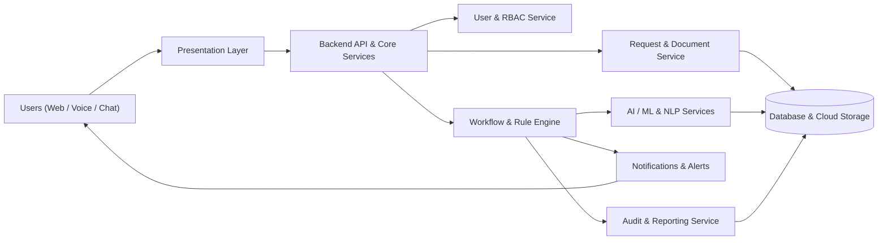

# System Architecture — Approval Management System Using AI

**Document Purpose:** Describes the system's technology layers, core components, candidate stack options, and runtime interactions consistent with `REQUIREMENT OG FILE/AI approval mgmt.docx`.

---

## 1. Technology Layers & Candidate Stack

| Layer | Candidate / Specified Technologies in Document | Status / Gaps |
| :--- | :--- | :--- |
| **Presentation (Frontend)** | HTML, CSS, JavaScript; framework options: **React**, **Angular**, or **Vue.js** | Single framework not yet selected; voice/chat UI framework unspecified. |
| **Application / Business Logic (Backend)** | **Node.js**, **Python (Django / Flask)**, or **Java (Spring Boot)** | Single runtime not yet selected; API protocol (e.g., REST/GraphQL) and async job/notification broker unspecified. |
| **AI / ML & NLP** | **Scikit-learn**, **TensorFlow**, **PyTorch**; NLP: **SpaCy** or **NLTK**; cloud managed AI/ML services | No choice made between classical ML vs deep learning/LLMs; speech-to-text (for voice) and model-serving architecture unspecified. |
| **Data & Storage** | Relational (**PostgreSQL**, **MySQL**) or NoSQL (**MongoDB**); cloud managed database and storage services | Choice of SQL vs NoSQL not finalized; blob/object storage for supporting documents and analytics store unspecified. |
| **Integration** | *Not specified in document* | Implied need for notification delivery, voice/chat channels, identity/HR, and finance/ERP systems, but no protocols or tools are named. |
| **Infrastructure & Observability** | **AWS**, **Google Cloud**, or **Azure**; managed DB, storage, and AI/ML services; monitoring and logging | Single cloud provider, compute model (containers/serverless/VMs), CI/CD, and monitoring/logging tools not specified. |

---

## 2. Core System Components

1. **Web Application UI:** Role-aware frontend for submitting requests, tracking status, reviewing AI recommendations, managing workflows/policies/users, and viewing monitoring dashboards and reports.
2. **Conversational / Voice Interface:** NLP-backed entry point allowing users to submit and process requests via chat or voice.
3. **API & Application Core:**
   - **Identity & RBAC Service:** Manages user profiles, roles (`requester`, `approver`, `manager`, `HR`, `administrator`), and access permissions.
   - **Request Service:** Handles request creation, supporting document ingestion, and status lifecycle tracking.
   - **Workflow & Rule Engine:** Evaluates organizational policies, executes multi-level sequential and parallel routing rules, and triggers automated approvals when eligible.
   - **Notification & Alert Service:** Dispatches status updates, pending-approval/deadline reminders, and anomaly alerts.
   - **Reporting & Audit Service:** Generates efficiency/trend metrics, powers dashboards, and records immutable audit trails of all approval activities.
4. **AI / ML Subsystem:**
   - **NLP Extractor:** Parses unstructured request descriptions to extract structured attributes and powers voice/chat intent handling.
   - **Decision Support & Risk Scorer:** Combines request data, policy rules, and historical patterns to produce approval recommendations, risk/compliance scores, and auto-approval eligibility.
   - **Anomaly Detection Engine:** Scores requests against historical baselines to flag unusual or potentially fraudulent activity.
   - **Predictive Analytics & Workflow Optimizer:** Forecasts request volume/trends, predicts bottlenecks/delays, and recommends workflow/rule improvements.
   - **Dynamic Rule Adapter:** Applies predefined rules and proposes/adjusts rules based on historical patterns and changing conditions.
5. **Data Persistence Layer:**
   - **Operational Store:** Request, approval, user, and policy data.
   - **Document Storage:** Cloud managed storage for supporting documentation attached to requests.
   - **Historical / Analytical Store:** Historical request, approval, and workflow pattern records used for reporting, forecasting, and AI model training.

---

## 3. Component Interactions & Primary Flows

1. **Request Submission & Enrichment:** A user submits a request via the Web UI or a voice/chat interface. The NLP component extracts structured fields from text descriptions, and the Request Service persists request data and supporting files.
2. **Rule Evaluation & AI Scoring:** The Workflow Engine reads Policy Data and sends request context to AI Services for automated rule application, anomaly detection, and risk/decision scoring.
3. **Routing or Automated Approval:**
   - If the request qualifies as routine/low-risk under active rules and AI thresholds, the Workflow Engine executes automated approval and logs the decision.
   - If an anomaly is detected, the Notification Service alerts approvers or administrators for manual review.
   - Otherwise, the request routes through sequential or parallel approval stages with scheduled deadline reminders.
4. **Decision Recording & Audit:** Approver actions (approve, reject, comments) update request status, write to the Approval Data and Audit Trail stores, and notify the requester.
5. **Analytics & Continuous Learning Loop:** Historical request and approval outcomes feed predictive analytics, workflow optimization recommendations, monitoring dashboards, and ongoing AI/ML model refinement.

---

## 4. Architectural Gaps & Decisions Required

> [!WARNING]
> **Unresolved Architectural Decisions:**
> - **Polyglot Backend vs. Unified Python Stack:** If Node.js or Java (Spring Boot) is chosen for the core backend while Python libraries (Scikit-learn, TensorFlow, PyTorch, SpaCy, NLTK) power AI/ML, an explicit internal service boundary (e.g., REST/gRPC microservice or async queue) must be designed.
> - **Sync vs. Async Execution:** AI inference, NLP extraction, document processing, and notifications may require asynchronous task queues to keep request submission fast and responsive (`NFR-02`).
> - **Database Split:** Relational storage fits structured workflows, RBAC, and transactional approvals, whereas unstructured request descriptions/logs may suit NoSQL or document extensions—this choice is left open.
> - **Governance on Dynamic Rules:** Architecture must clarify whether `AI-12` (dynamic rule adjustment) auto-applies changes or stages them for administrator approval.
